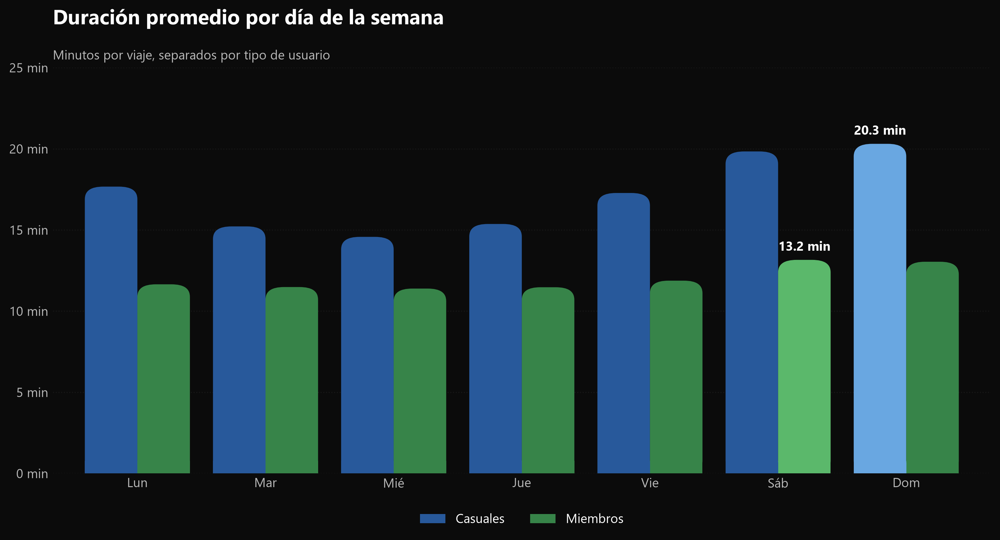
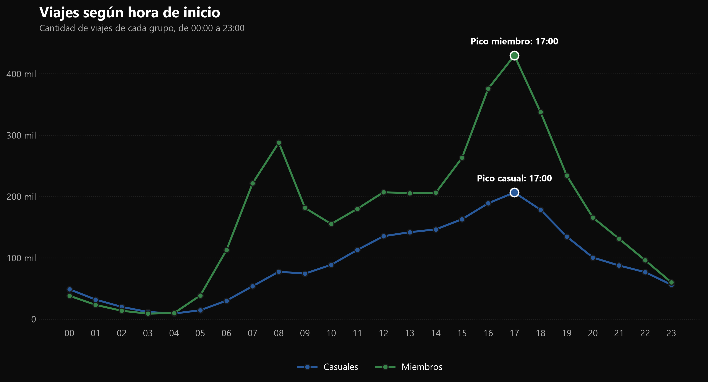
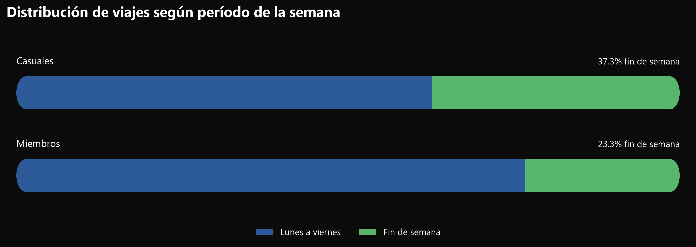
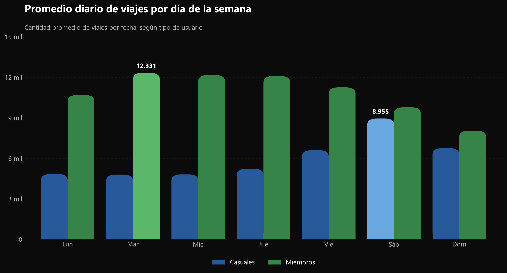
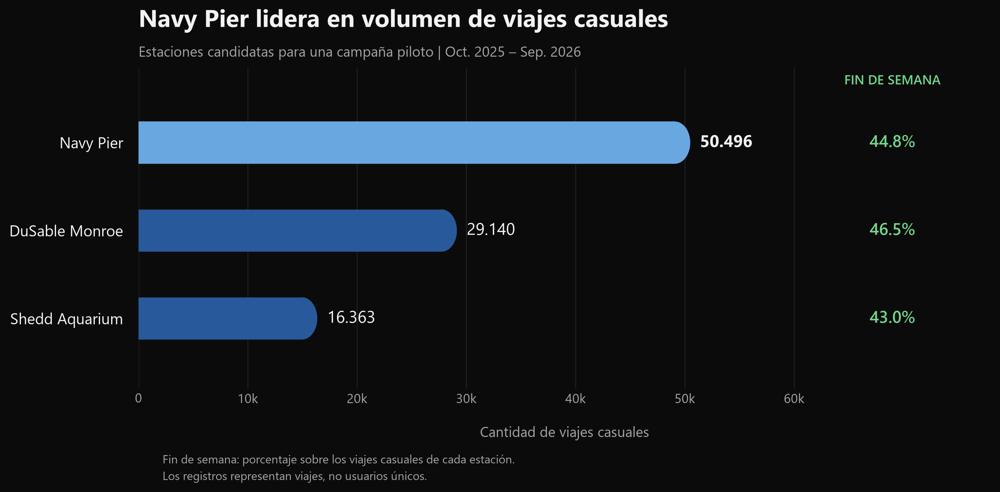

# Cyclistic Bike-Share Analysis 🚲

### Google Data Analytics Capstone | Python

## Descripción del proyecto

Cyclistic es una empresa ficticia de bicicletas compartidas que busca aumentar la cantidad de miembros anuales mediante estrategias de marketing basadas en datos.

Este proyecto analiza **6.171.650 viajes registrados entre octubre de 2025 y septiembre de 2026** para identificar diferencias en los patrones de uso entre miembros anuales y usuarios casuales.

El objetivo es transformar estos hallazgos en recomendaciones comerciales que puedan orientar futuras campañas de conversión.

## Pregunta de negocio

**¿Cómo utilizan las bicicletas los miembros anuales y los usuarios casuales de manera diferente?**

## Datos y herramientas

**Fuente:** registros públicos de viajes de Divvy, Chicago, utilizados para el caso de estudio de Cyclistic.

**Período:** octubre de 2025 a septiembre de 2026.

**Herramientas utilizadas:**
- Python
- pandas
- NumPy
- Matplotlib
- JupyterLab

## Análisis completo

Todo el proceso de preparación, limpieza, análisis y visualización está documentado en el siguiente notebook:

[Ver notebook completo](notebooks/01_exploracion_datos.ipynb)

## Preparación y limpieza de datos

Se combinaron 12 archivos CSV mensuales que contenían inicialmente **6.171.785 registros**.

Durante la limpieza se realizaron las siguientes operaciones:

- Eliminación de 35 registros duplicados.
- Exclusión de 29 viajes con duraciones negativas.
- Exclusión de 71 viajes iniciados fuera del período de estudio.
- Revisión de valores faltantes en estaciones y coordenadas.
- Evaluación de 5.317 viajes con duraciones superiores a 24 horas, excluidos únicamente de los cálculos principales de duración.

**Dataset final: 6.171.650 viajes.**

## Principales hallazgos

### 1. Duración de los viajes

Los viajes casuales presentan una duración promedio superior a los viajes de miembros anuales durante todos los días de la semana.

El domingo, los viajes casuales alcanzan una duración promedio de aproximadamente **20,3 minutos**, mientras que los miembros registran su máximo el sábado, con **13,2 minutos**.

### 2. Patrones horarios

Los miembros muestran picos de actividad alrededor de las **08:00 y las 17:00**, compatibles con desplazamientos cotidianos.

Los viajes casuales presentan un crecimiento más gradual durante el día, alcanzando también su máximo a las 17:00.

A las 08:00 comienza el **7,22 % de los viajes de miembros**, frente al **3,54 % de los viajes casuales**.

### 3. Distribución semanal

El **37,31 % de los viajes casuales** ocurre durante los fines de semana, frente al **23,27 % de los viajes de miembros**.

Esto indica una mayor concentración relativa de actividad casual durante sábados y domingos.

### 4. Actividad diaria

Los sábados registran el mayor promedio de viajes casuales, con aproximadamente **8.955 viajes diarios**.

Por su parte, los miembros alcanzan su máximo los martes, con aproximadamente **12.331 viajes diarios**.

La actividad casual de un sábado promedio es aproximadamente un 86 % superior a la de un martes promedio para ese mismo grupo.

### 5. Oportunidades geográficas

Se compararon tres estaciones con un elevado volumen de viajes casuales: Navy Pier, DuSable Lake Shore Dr & Monroe St y Shedd Aquarium.

**Navy Pier registra 50.496 viajes casuales**, el mayor volumen entre las tres estaciones seleccionadas.

Además, aproximadamente el **44,82 % de sus viajes casuales ocurre durante los fines de semana**.

Estos resultados la convierten en una ubicación candidata para evaluar una campaña piloto de conversión.

## Recomendaciones comerciales

### 1. Implementar una campaña piloto en Navy Pier

Evaluar una campaña de promoción de membresías anuales en Navy Pier, especialmente durante los fines de semana.

Medir las conversiones atribuibles a la campaña y, de ser posible, utilizar un grupo de control antes de considerar su expansión a otras estaciones.

### 2. Priorizar los sábados para las campañas dirigidas a usuarios casuales

Los sábados presentan el mayor volumen promedio diario de viajes casuales.

Se recomienda probar acciones publicitarias durante los períodos de mayor actividad, evaluando las conversiones y los costos de cada campaña.

### 3. Adaptar los mensajes comerciales a diferentes patrones de uso

Los usuarios casuales presentan viajes más largos y mayor concentración relativa durante los fines de semana.

Los miembros anuales muestran patrones horarios compatibles con desplazamientos cotidianos.

Se recomienda probar comunicaciones diferenciadas que expliquen los posibles beneficios de una membresía para distintos hábitos de uso, considerando las condiciones tarifarias reales.

## Limitaciones del análisis

Los registros representan **viajes y no usuarios únicos**.

Por lo tanto, no permiten identificar usuarios casuales recurrentes, calcular su frecuencia individual de uso ni determinar directamente su disposición a adquirir una membresía anual.

Además, los patrones horarios y semanales no permiten conocer con certeza los motivos de los viajes.

Las recomendaciones propuestas requieren validación mediante experimentos y métricas de conversión.

## Conclusión

El análisis permitió identificar diferencias relevantes entre miembros anuales y usuarios casuales en la duración de los viajes, los horarios de inicio y la distribución semanal de la actividad.

Los resultados son compatibles con un uso más recreativo entre los usuarios casuales y un patrón más vinculado a desplazamientos cotidianos entre los miembros.

Estos hallazgos ofrecen una base para orientar estrategias de marketing segmentadas por ubicación, momento de uso y patrones de comportamiento.

La efectividad de las campañas propuestas deberá evaluarse antes de considerar una implementación a mayor escala.
